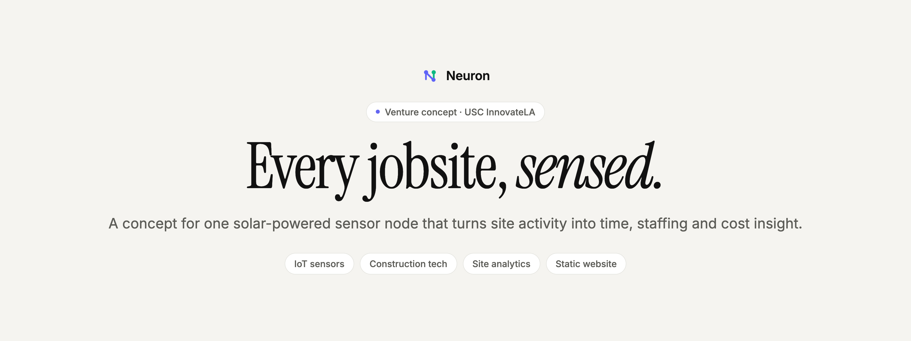
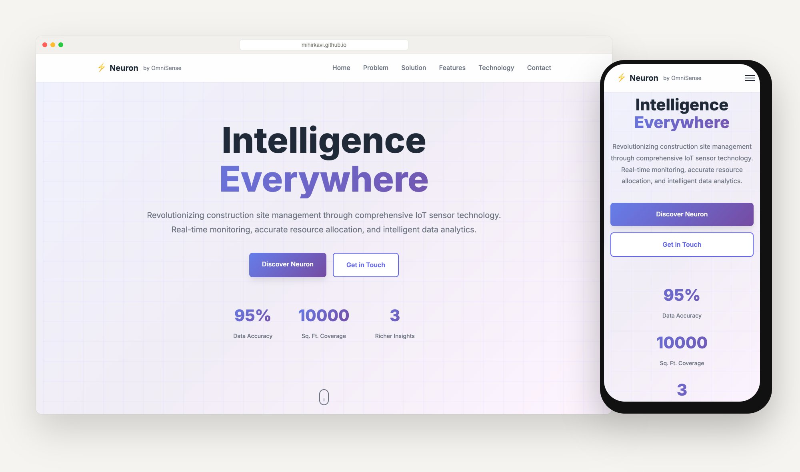
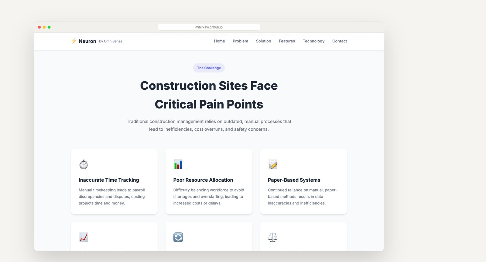
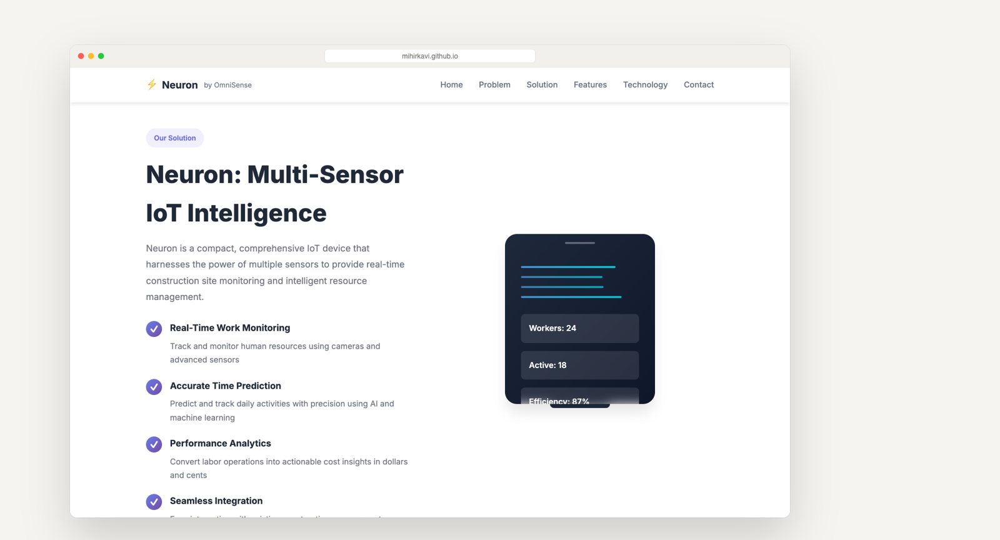
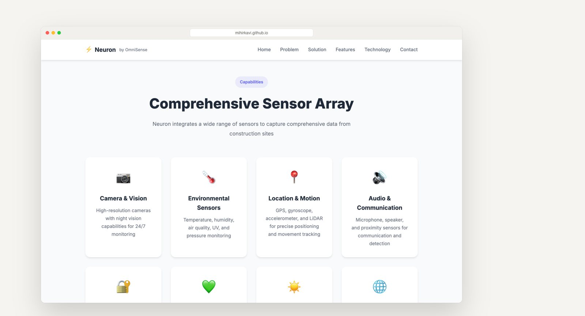
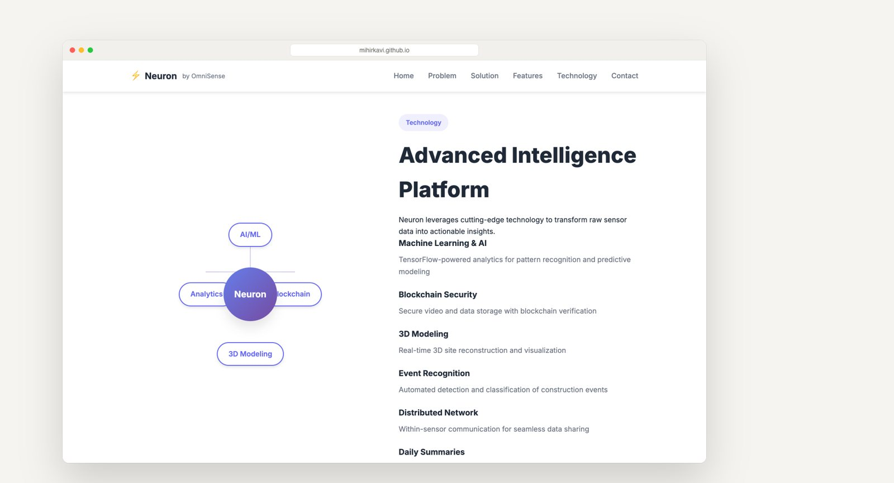
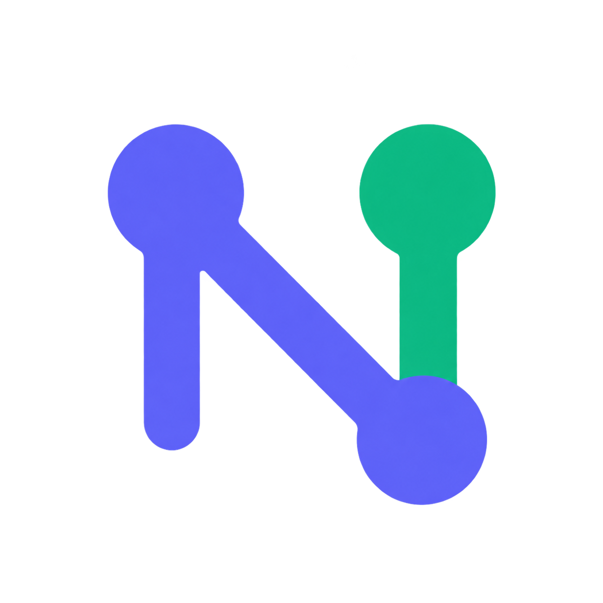

<p align="center">
  <a href="https://mihirkavi.github.io/Neuron/">
    <picture>
      <source media="(prefers-color-scheme: dark)" srcset=".github/assets/banner-dark.png">
      
    </picture>
  </a>
</p>

<p align="center">
  <strong>One sensor node for a smarter jobsite.</strong><br>
  Neuron is a venture concept for construction sites: a compact, solar-powered IoT device that would replace paper timesheets and guesswork with live site data.
</p>

<p align="center">
  <a href="https://mihirkavi.github.io/Neuron/"><strong>Concept website</strong></a> ·
  <a href="#a-quick-tour"><strong>Tour</strong></a> ·
  <a href="#whats-in-this-repository"><strong>What's inside</strong></a> ·
  <a href="#view-it-locally"><strong>View locally</strong></a> ·
  <a href="#honest-status"><strong>Honest status</strong></a>
</p>

<p align="center">
  
  
  
  
</p>

<p align="center">
  
</p>

## Why Neuron

Most construction sites still run on paper timesheets, phone calls and end-of-day guesses. Managers struggle to know who is on site, whether crews are over- or under-staffed, and what a day of labor really cost, until the overrun shows up in the budget.

**Neuron imagines one small device that sees the whole site.** Mount a solar-powered node with a camera, environmental and motion sensors, and it would log activity automatically, predict how long work will take, and turn labor into dollars-and-cents reports. The repository holds the pitch website and the research behind the idea.

<table>
  <tr>
    <td width="33%" valign="top">
      <h3>⏱️ Time, tracked for you</h3>
      Replace manual timekeeping with sensor-based activity logs, so payroll disputes and lost hours stop piling up.
    </td>
    <td width="33%" valign="top">
      <h3>👷 Right crew, right day</h3>
      Live site data helps balance staffing, so projects avoid both shortages and paying for idle hands.
    </td>
    <td width="33%" valign="top">
      <h3>📊 Insight in dollars</h3>
      Daily summaries convert labor operations into cost insight that owners, managers and investors can act on.
    </td>
  </tr>
</table>

> **Proposed, not built:** every capability above is part of the product concept. See [Honest status](#honest-status).

## A quick tour

The concept website walks through the problem, the device, its sensors and the software platform around it.

<table>
  <tr>
    <td width="50%" valign="top">
      
      <h4>The problem</h4>
      Six everyday pain points, from paper timesheets to labor-law compliance.
    </td>
    <td width="50%" valign="top">
      
      <h4>The device</h4>
      One compact node for work monitoring, time prediction and performance analytics.
    </td>
  </tr>
  <tr>
    <td width="50%" valign="top">
      
      <h4>The sensor array</h4>
      Camera, environmental, motion, audio, access and solar power, as proposed.
    </td>
    <td width="50%" valign="top">
      
      <h4>The platform</h4>
      The planned software layer: AI analytics, event recognition, 3D models and daily reports.
    </td>
  </tr>
</table>

<sub>Screenshots of the live concept website, captured with a headless browser. Figures on the site (such as "95% data accuracy" and the market sizes) are pitch targets from the venture materials, not measured results.</sub>

## What's in this repository

| | Area | What you will find |
| --- | --- | --- |
| 🌐 | **Concept website** | `index.html`, `styles.css`, `script.js`: a static, responsive pitch site, live on [GitHub Pages](https://mihirkavi.github.io/Neuron/) |
| 📄 | **Product** | Product requirements (PRD), problem statement, one-pager, proposal and a patent draft |
| 💼 | **Business** | Business model canvas, financial projection, market-size research and pitch deck |
| 🔬 | **Research** | A literature survey and a white paper on AI in construction management |
| 🎓 | **Program** | InnovateLA workshop materials: problem identification, customer discovery, ideation and prototyping |

## View it locally

No build step. From the repository root:

```bash
python3 -m http.server 8000
```

Then open <http://localhost:8000>. The Office and PDF documents open in any compatible app.

## Honest status

Neuron is a **product concept and research archive**, not a working monitoring platform.

- There is **no hardware, firmware or sensor integration** in this repository. Raspberry Pi hardware, the sensor array, AI analytics, blockchain storage and 3D modeling are proposed capabilities.
- The website's statistics, worker counters and market figures are **illustrative pitch numbers**, not results from a deployment.
- The contact form **simulates** submission in the browser; it does not send a message anywhere.
- Any real deployment would need careful privacy, consent and labor-law review, because the concept involves cameras and worker monitoring.

<details>
<summary><strong>Team, origin and notes for agents</strong></summary>
<br>

**Team.** Mihir Kavishwar and Neel Patil, developed in the context of the University of Southern California's Sonny Astani Department of Civil & Environmental Engineering for the InnovateLA Das Family Competition.

**Notes for agents.** The site is plain HTML, CSS and JavaScript with no dependencies. `GITHUB_PAGES.md` records how Pages is configured (branch `main`, root folder). README images live in [`.github/assets`](.github/assets); brand artwork lives in [`assets/brand`](assets/brand/README.md).

</details>

<!-- project-artwork:start -->
## Project artwork


<sub>Conceptual project artwork, not a photo of a product or deployment. [Asset files, design notes, and generation prompts](assets/brand/README.md).</sub>
<!-- project-artwork:end -->

## License

No license file is included in this repository. This README grants no additional reuse or redistribution permissions; contact the repository owner about permitted use.

<p align="center">
  <br>
  <br>
  <sub><strong>Neuron</strong> by OmniSense · Every jobsite, sensed.</sub>
</p>
